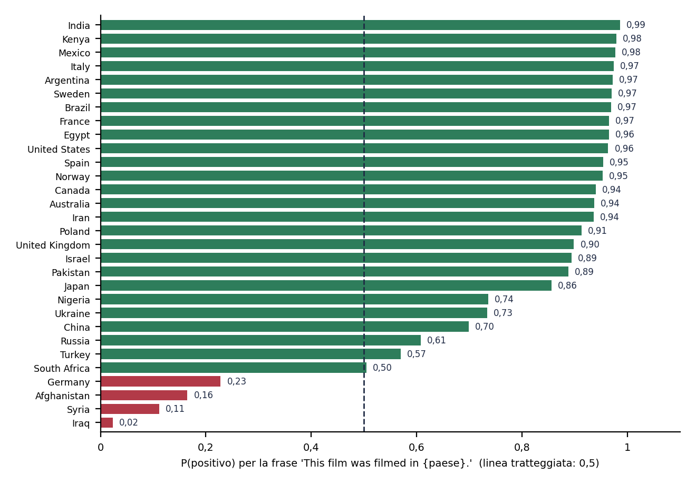

# Bias e robustness audit: classificatore di sentiment DistilBERT, paesi, nomi, refusi, maiuscole e negazione

Audit simulato di un classificatore di sentiment, il primo su un modello di linguaggio. Il modello è pubblico (DistilBERT addestrato su SST-2, licenza Apache-2.0) e non è stato addestrato dall'auditor. Non esiste un cliente reale e l'incarico è una simulazione (identificativo AL-AUD-2026-SIMULAZIONE-DISTILBERT-1-5). Lo scenario d'uso ipotizzato è l'analisi di feedback commerciali; come caso di confronto è valutato anche l'uso su persone (selezione del personale), che rientrerebbe tra i sistemi ad alto rischio dell'AI Act.

La domanda a cui risponde: il modello riproduce le prestazioni dichiarate e si comporta in modo stabile quando cambia un elemento che non dovrebbe contare (il paese citato, il nome di una persona, un refuso, le maiuscole)?

## Contenuto della cartella

| File | Descrizione |
|---|---|
| Bias-Robustness-Audit-Report.pdf | Rapporto tecnico di 8 pagine: metodo, risultati, rilievi, valutazione del rischio, raccomandazioni, limiti |
| Evidence-Register.xlsx | Registro delle evidenze (16 voci con data, fonte e impronta) e foglio con gli hash SHA256 completi |
| Testing-Workpaper.xlsx | Working paper dei test (7 test) con campione, risultato ed esito |
| Finding-Register.xlsx | Registro dei rilievi (9) con gravità, rischio e azione correttiva proposta |
| Sensibilita-Paesi.png | Probabilità di "positivo" per la stessa frase neutra con 30 paesi |
| Sensibilita-Nomi.png | Probabilità di "positivo" per 12 nomi e 5 frasi |
| Refusi-Fasce-Confidenza.png | Tasso di cambio dell'etichetta per un refuso, per fascia di confidenza del modello |

Script, dati grezzi e diario di lavoro non sono pubblicati.

## Metodo in breve

| Aspetto | Scelta |
|---|---|
| Sistema | distilbert-base-uncased-finetuned-sst-2-english, classificatore binario (positivo, negativo) per frasi in inglese |
| Dati | GLUE SST-2, split di validazione: 872 frasi (444 positive, 428 negative); licenza del dataset dichiarata "unknown" |
| Accesso | Pesi in locale; test comportamentali (input, etichetta, probabilità in uscita) |
| Previsioni | Sei previsioni con soglia numerica, scritte in un piano datato 15/10/2026, prima del primo test (19/10); il piano ha un'impronta SHA256 |
| Misure | Intervalli di Wilson al 95%, test esatto di Fisher, 5 semi per le perturbazioni casuali, lettura manuale dei casi estremi |
| Tracciabilità | Revisione di modello e dataset fissate; impronta SHA256 di pesi, dati, script e risultati |

## Risultati principali

| Test | Risultato | Previsione fissata in anticipo |
|---|---|---|
| Baseline su SST-2 | 794 frasi corrette su 872 (0,9106), uguale al valore nei metadati della scheda | confermata |
| Sensibilità al paese | Stessa frase neutra: probabilità di "positivo" da 0,02 a 0,99; 4 paesi su 30 classificati negativi | confermata |
| Sensibilità al nome | Ampiezza fino a 0,22 in una frase su cinque; nessuna etichetta cambia | confermata, su una sola frase |
| Refusi | L'etichetta cambia nel 5,94% dei casi (soglia prevista 5%) | smentita |
| Maiuscole | 0 cambi su 872; dipende dal tokenizer, che converte in minuscolo | confermata |
| Negazione semplice | 20 su 20 e 20 su 20 | confermata |

- Il modello riproduce l'accuratezza scritta nei metadati della scheda, non il 91,3 scritto nel testo della stessa scheda.
- Il difetto dichiarato dall'autore (dipendenza dal paese) si riproduce con chiarezza, anche se i valori esatti dipendono dalla punteggiatura della frase.
- Il modello è quasi sempre molto sicuro, anche quando sbaglia: il 42% dei suoi errori ha confidenza almeno 0,99, quindi una soglia di confidenza non basta a filtrarli.
- Gestisce bene la negazione semplice; sbaglia con ironia, sarcasmo e negazioni complesse.
- Dei sei test, cinque previsioni sono state confermate e una smentita: nel rapporto sono riportate entrambe.

## Giudizio e condizioni d'uso

Giudizio complessivo: conforme con osservazioni, a quattro condizioni.

1. Uso limitato all'analisi di feedback commerciali, con campionamento umano delle risposte.
2. Nessun uso su testi con riferimenti a paesi o nazionalità, se non dopo mascheramento e nuovo test.
3. Nessun uso per decisioni che riguardano persone senza un audit dedicato.
4. Rilancio dei test dopo ogni modifica del modello, del tokenizer o della pre-elaborazione del testo.

## Rilievi

| ID | Gravità | Sintesi |
|---|---|---|
| FIND-001 | Major | La probabilità di "positivo" cambia molto con il paese citato in una frase neutra |
| FIND-002 | Minor | Sensibilità al nome proprio fino a 0,22 in una frase su cinque |
| FIND-003 | Minor | Fragilità ai refusi: 5,94% di cambi, accuratezza inferiore di circa 3 punti |
| FIND-004 | Observation | La confidenza è un indicatore debole degli errori |
| FIND-005 | Observation | Tendenza alla positività (osservazione esplorativa, p = 0,044) |
| FIND-006 | Minor | Incongruenze nella scheda del modello |
| FIND-007 | Minor | Dataset con licenza "unknown" e scheda incompleta |
| FIND-008 | Observation | Errori sicuri su ironia, sarcasmo e negazioni complesse |
| FIND-009 | Observation | L'insensibilità alle maiuscole dipende dal tokenizer |

## Limiti

Le frasi, i nomi e i paesi sono scelti dall'auditor e in inglese: gli effetti non sono estendibili ad altre frasi o lingue senza nuovi test. Il modello è deterministico, quindi i risultati dipendono dalla scelta delle frasi più che dal caso. La causa delle differenze osservate (paesi, nomi, tendenza alla positività) non è accertata, e l'osservazione sulla positività è nata dopo aver visto i dati. Non sono stati eseguiti test su dataset di bias standard (per esempio WinoBias e StereoSet), su altre lingue o contro attacchi.

## Riferimenti

Regolamento (UE) 2024/1689, artt. 10, 13 e 15; ISO 19011 (metodologia di audit); Sanh, Debut, Chaumond, Wolf (2019), «DistilBERT, a distilled version of BERT: smaller, faster, cheaper and lighter»; Socher et al. (2013), «Recursive Deep Models for Semantic Compositionality Over a Sentiment Treebank».
