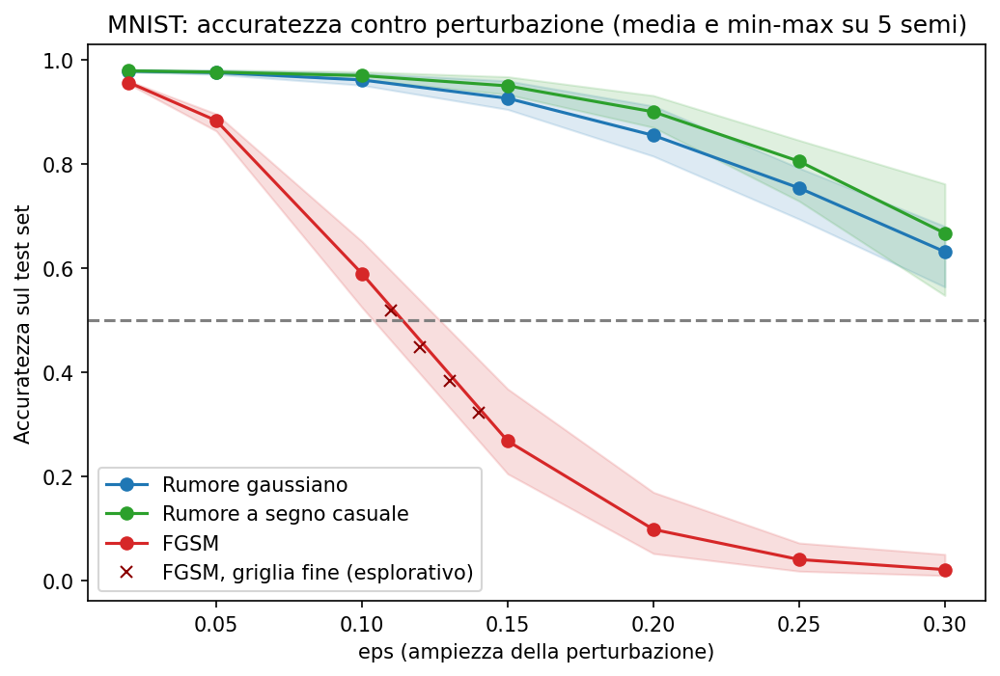

# Robustness audit: classificatore di cifre MNIST, rumore casuale contro attacco FGSM

Audit simulato di robustezza su una rete convoluzionale per la lettura di cifre scritte a mano. Il modello è stato costruito e addestrato dall'auditor per questo esercizio: non esiste un cliente reale e l'incarico è una simulazione (identificativo AL-AUD-2026-SIMULAZIONE-MNIST-1-4). Lo scenario d'uso ipotizzato è la lettura automatica di cifre su moduli, ad esempio importi.

La domanda a cui risponde: quanto regge il modello a perturbazioni dell'input, e il rumore casuale è un buon indicatore della robustezza contro un attacco mirato?

## Contenuto della cartella

| File | Descrizione |
|---|---|
| Robustness-Audit-Report.pdf | Rapporto tecnico: metodo, risultati, verifica delle previsioni, rilievi, raccomandazione sull'uso, limiti |
| Evidence-Register.xlsx | Registro delle evidenze (12 voci) |
| Testing-Workpaper.xlsx | Working paper dei test (12 test) con esito e campione |
| Finding-Register.xlsx | Registro dei rilievi (6) con gravità, rischio e azione correttiva proposta |
| Curva-Accuratezza.png | Accuratezza contro ampiezza della perturbazione, media e min-max su 5 addestramenti |
| Esempi-Perturbazioni.png | Otto cifre originali, con rumore e con attacco, e relative predizioni |

Script e dati di lavoro non sono pubblicati.

## Metodo in breve

| Aspetto | Scelta |
|---|---|
| Sistema | CNN a 10 classi, 5 addestramenti con semi diversi |
| Dati | MNIST, 10.000 immagini di test |
| Perturbazioni | Rumore gaussiano, rumore a segno casuale, attacco FGSM (libreria ART) |
| Accesso al modello | Completo (pesi e gradienti): stima prudente, caso peggiore |
| Misure | Accuratezza con intervallo di Wilson per singolo risultato e intervallo t al 95% sui 5 addestramenti |
| Previsioni | Scritte nel piano prima di ogni addestramento e confrontate con i risultati |

## Risultati principali

| Condizione (ampiezza 0,15) | Accuratezza media | Intervallo 95% sui 5 addestramenti |
|---|---|---|
| Dato pulito | 0,979 | 0,977-0,981 |
| Rumore gaussiano | 0,926 | 0,900-0,952 |
| Rumore a segno casuale | 0,950 | 0,934-0,965 |
| Attacco FGSM | 0,267 | 0,164-0,370 |

- A pari norma della perturbazione, il rumore casuale lascia l'accuratezza oltre 0,92 mentre l'attacco mirato la porta a 0,27: il divario dipende dalla direzione della perturbazione, non dalla grandezza.
- La soglia di rottura (accuratezza sotto 0,50) sta tra ampiezza 0,11 e 0,13 per l'attacco; col rumore non viene raggiunta fino a 0,30.
- La fragilità sotto attacco è concentrata su poche cifre (in media l'8 e il 9) e cambia con il singolo addestramento: la media nasconde sia questo sia la variabilità tra addestramenti.
- Delle sei previsioni scritte in anticipo, tre sono state confermate e tre smentite; nel rapporto sono riportate entrambe.

## Rilievi

| ID | Gravità | Sintesi |
|---|---|---|
| FIND-001 | Major | Il modello cede a perturbazioni mirate piccole |
| FIND-002 | Minor | Fragilità concentrata su poche classi, nascosta dall'aggregato |
| FIND-003 | Minor | La robustezza dipende dall'addestramento |
| FIND-004 | Observation | Degrado col rumore casuale non trascurabile |
| FIND-005 | Observation | Accuratezza pulita e robustezza al rumore non predicono la robustezza avversariale |
| FIND-006 | Observation | Fonte e licenza del dato non documentate |

## Limiti

L'attacco usato è debole (FGSM), non sono stati provati attacchi più forti né scenari senza accesso al modello; il modello è didattico e MNIST non rappresenta scansioni reali; con cinque addestramenti gli intervalli sulle medie avversariali sono larghi; la causa della fragilità di alcune cifre non è accertata.

## Riferimenti

Regolamento (UE) 2024/1689, art. 15 (accuratezza, robustezza, cybersicurezza); ISO 19011 (metodologia di audit); Goodfellow, Shlens, Szegedy (2015), «Explaining and Harnessing Adversarial Examples».
